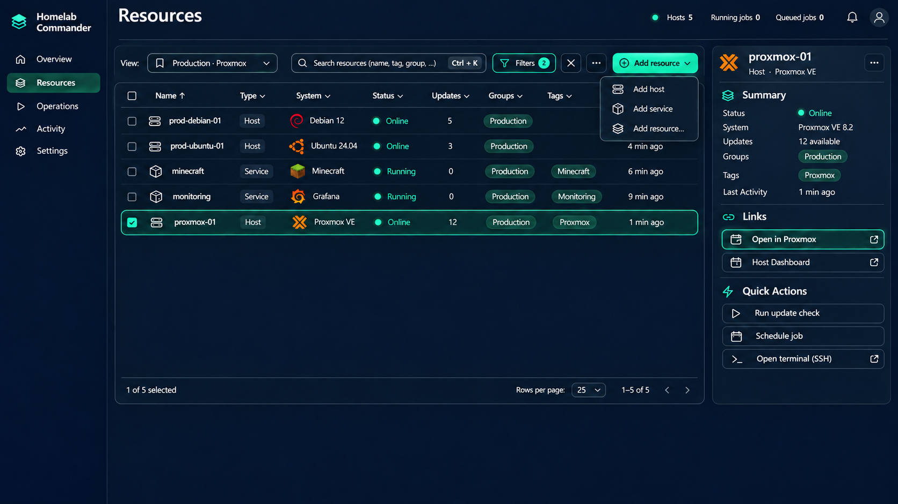
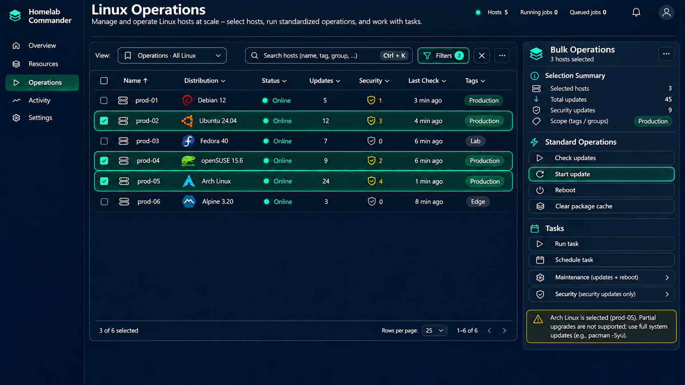
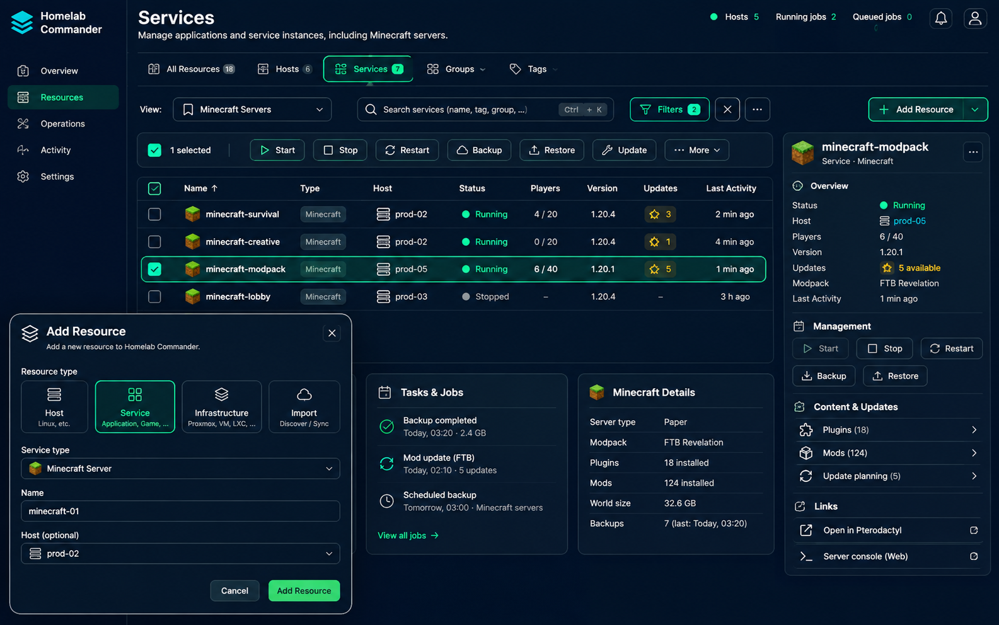
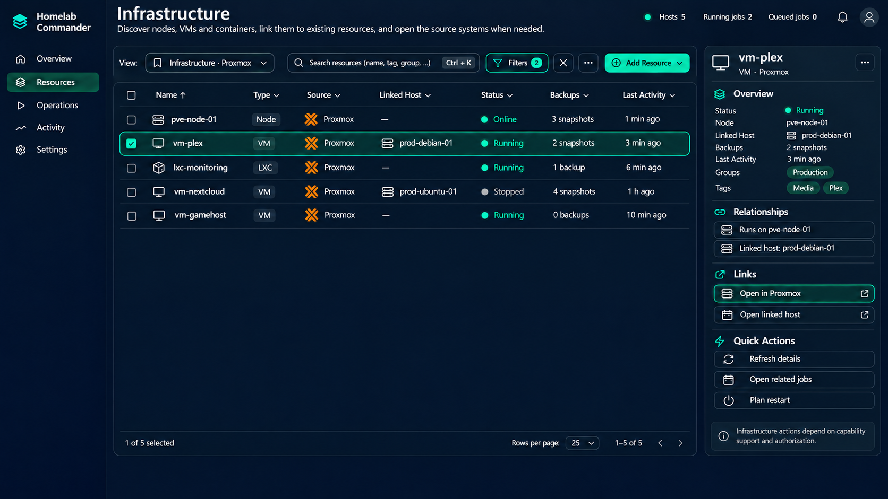
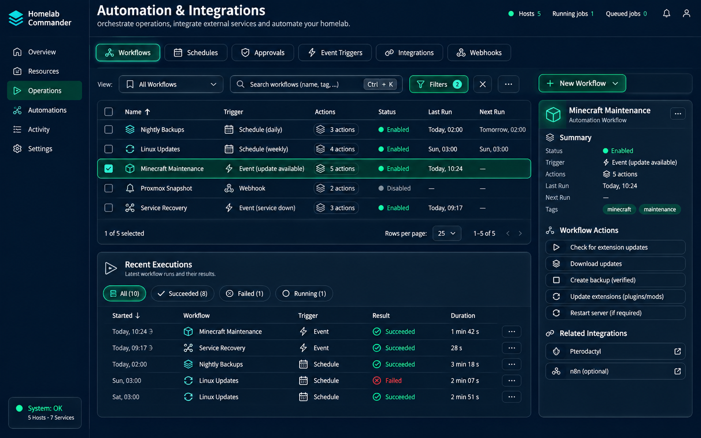
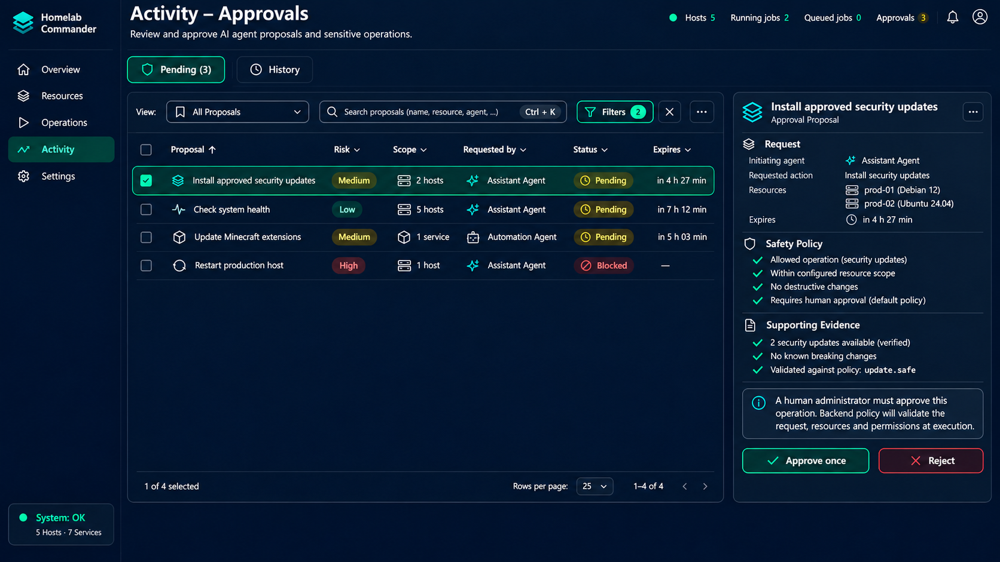

# Milestone UI concept references

All six owner-supplied PNGs were visually inspected and copied from the ignored
`tmp/` directory. No assets are missing and no unrelated temporary files were moved.
They contain illustrative names, not imported infrastructure data. Original images
are retained as reference artifacts, never application UI or executable requirements.

The [navigation contract](../navigation-and-workflows.md) and approved
[specification](../../01-product/future-platform-specification.md) govern scope.
Images may contain duplicate controls, unimplemented actions or inconsistent labels;
those discrepancies do not override the contracts. M5 and M6 remain provisional.

## M1 — Resources

Discovery, contextual selection and details. No terminal or scheduling entry is implemented.

**UI Concept – Non-binding visual example**

> This mockup illustrates one possible visual layout. It may contain unimplemented features and does not amend the approved specification, issue acceptance criteria, provider contracts or authorization rules.

## M2 — Linux operations

Direct actions with provider-specific safety; no additional package manager is implemented.

**UI Concept – Non-binding visual example**

> This mockup illustrates one possible visual layout. It may contain unimplemented features and does not amend the approved specification, issue acceptance criteria, provider contracts or authorization rules.

## M3 — Services

Managed Service placement and optional Host linkage. The duplicate action strips in this concept are not adopted.

**UI Concept – Non-binding visual example**

> This mockup illustrates one possible visual layout. It may contain unimplemented features and does not amend the approved specification, issue acceptance criteria, provider contracts or authorization rules.

## M4 — Infrastructure

Relationships and source-system links, not a Proxmox UI replacement.

**UI Concept – Non-binding visual example**

> This mockup illustrates one possible visual layout. It may contain unimplemented features and does not amend the approved specification, issue acceptance criteria, provider contracts or authorization rules.

## M5 — Automation and integrations

Provisional UX. Its extra Automations navigation item is not the agreed five-destination map; no scheduling is enabled.

**UI Concept – Non-binding visual example**

> This mockup illustrates one possible visual layout. It may contain unimplemented features and does not amend the approved specification, issue acceptance criteria, provider contracts or authorization rules.

## M6 — AI operations

Provisional approval UX. Expiry remains visible; proposals are separate from queued jobs. No agent or approval functionality is implemented.

**UI Concept – Non-binding visual example**

> This mockup illustrates one possible visual layout. It may contain unimplemented features and does not amend the approved specification, issue acceptance criteria, provider contracts or authorization rules.

