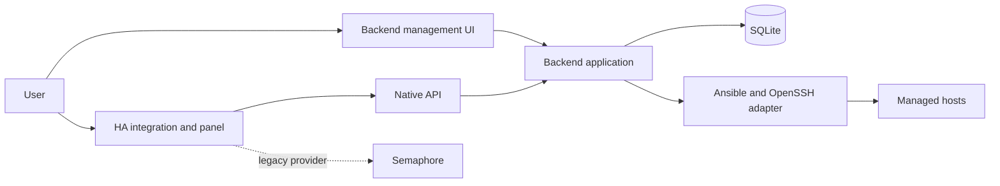

# Architecture and contracts

## Dependency direction

Entity platforms depend on application-facing services/protocols. Adapters translate
external payloads into typed immutable domain models. Entities do not know endpoint
paths, provider JSON or transport details, and entity properties perform no I/O.

The native backend separately owns API, application services, persistence and
execution adapters. Package-provider semantics are separate from SSH transport.
A new capability should extend a bounded protocol/use case rather than scatter
provider-specific branches through entities.

## Trust boundaries

The integration receives an API token, not a private SSH identity. The backend
owns its privileged identity and persistent jobs. The App adds Supervisor lifecycle
and Ingress packaging without a Docker socket or host network. Management UI auth
and external API auth remain separate.

## Architecture decisions

The [ADR index](../../02-architecture/adr/README.md) preserves all existing records:
ports/adapters, public-safe data, quality baseline, explicit reboot, native backend
boundary, standalone sessions, HA panel, public images and local App discovery.
Do not translate or rewrite an accepted historical ADR in place merely to change
navigation. Link it and add a superseding ADR when a decision changes.

Read the relevant ADRs before changing public contracts, persistence, security
boundaries, dependency direction or backend abstraction. Detailed component/data
flows remain in the [architecture overview](../../02-architecture/overview.md).
