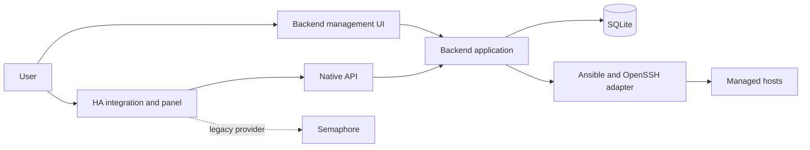

# Architecture and contracts

## Dependency direction

Entity platforms depend on application-facing services/protocols. Adapters translate
external payloads into typed immutable domain models. Entities do not know endpoint
paths, provider JSON or transport details, and entity properties perform no I/O.

The native backend separately owns API, application services, persistence and
execution adapters. Package-provider semantics are separate from SSH transport.
A new capability should extend a bounded protocol/use case rather than scatter
provider-specific branches through entities.

## Trust boundaries

The integration receives an API token, not a private SSH identity. The backend
owns its privileged identity and persistent jobs. The App adds Supervisor lifecycle
and Ingress packaging without a Docker socket or host network. Management UI auth
and external API auth remain separate.

## Architecture decisions

The [ADR index](../../02-architecture/adr/README.md) preserves all existing records:
ports/adapters, public-safe data, quality baseline, explicit reboot, native backend
boundary, standalone sessions, HA panel, public images and local App discovery.
Do not translate or rewrite an accepted historical ADR in place merely to change
navigation. Link it and add a superseding ADR when a decision changes.

Read the relevant ADRs before changing public contracts, persistence, security
boundaries, dependency direction or backend abstraction. Detailed component/data
flows remain in the [architecture overview](../../02-architecture/overview.md).

## Resource and capability contract proposal (#41)

The next architecture block introduces [inert typed contracts](../../02-architecture/resource-capability-contracts.md)
for Host/Managed Service identities, optional host association, directed relationships,
versioned capabilities and typed provider validation/assessment. These declarations
are a review proposal, not new UI actions or installed providers. Existing Host UUIDs,
SSH identity, jobs, review states, HA identifiers and `/api/v1` stay compatible.

Supported, unsupported, unavailable and policy-blocked are distinct states. Technical
availability never authorizes execution. The registry follows below; generic jobs,
policy enforcement and real provider expansion remain separate downstream issues. See
[ADR-0022](../../02-architecture/adr/0022-resource-and-capability-contracts.md).

## Registry implementation and module layout

The follow-up registry block groups domain values, application/store ports, SQLite
adapter and HTTP schemas/router under `resources/`. Storage and migration code
lives under `persistence/`, while compatibility imports and the Host facade remain
available. This establishes working boundaries incrementally; Linux extraction and
policy/generic jobs remain later work. FastAPI and SQLite stay the foundation.
[ADR-0023](../../02-architecture/adr/0023-resource-registry-and-module-boundaries.md)
records the migration and dependency maintenance decisions.

## Groups and tags

The groups feature isolates pure bounded rules and immutable facts from SQLite and HTTP. See [ADR-0024](../../02-architecture/adr/0024-bounded-resource-groups.md) for fail-closed evaluation and future target revalidation.

## Operator UI foundation (review branch)

Resources integrates the existing group/tag inventory through filters and contextual
editing. Pure list-state/rendering ES modules use an injected bridge to the legacy
shell's transport, CSRF and safe diagnostics. The same Ingress asset boundary applies.
The [design contracts](../../design/README.md) and
[cross-layer inventory](../../design/architecture-inventory.md) distinguish this
implemented slice from the proposed sidebar, legacy-list and policy work. ADR-0025
remains proposed; no framework, provider privilege or new migration is introduced.
